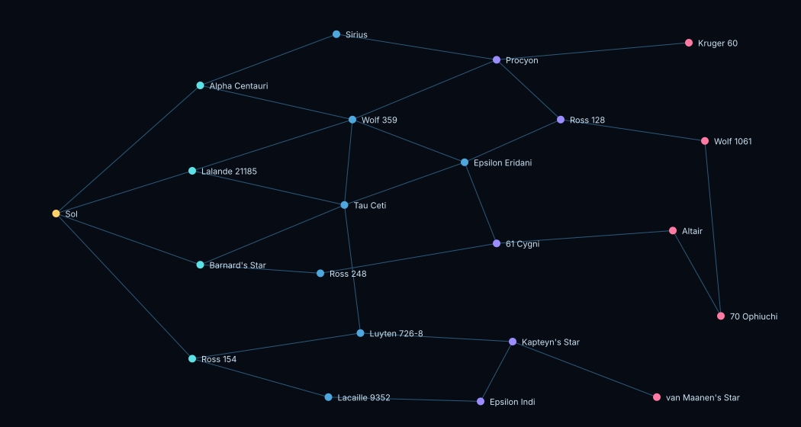

# The 20+ system map (ISP-113, AB#805)

Design, not data: AB#806 and AB#807 put this into `data/systems.json` (one source since AB#804) and `data/research.json`.
22 systems: the six that exist and 16 new ones. Every new system is a real star among the 100 nearest,
from RECONS' list (Research Consortium On Nearby Stars, "The 100 nearest star systems", accurate as of 1 January 2012).
Distances are from each system's trigonometric parallax on that list, rounded to 0.1 light year. Planets named as
known exoplanets are real; every other body, owner rule and belt is game fiction.

Everything a player can compare here is a **model**, not play (P-PROXY): value per 100 units an expedition rolls, at
today's NPC bids, with today's rarity multiplier and cargo fee.

## What the map has to work with (the code today)

- **Travel** follows `adjacent` edges. It costs 1 hour a hop (`server/travel.js`, `getInterstellarTravelTimeMs`). Moving
  the corporation costs no credits. Cargo sent between systems pays 3 credits a unit a jump
  (`data/economy.json` `logistics.perJumpFeePerUnit`). `mapPosition` is display only.
- **A gate** is a system's `accessResearch` (`public/scripts/navigation.js` `canReachSystem`, enforced by the travel
  route). A research node may carry `requiresCorpLevel`: Near-Star Navigation needs Level 5, Deep-Star Cartography Level 10.
- **Rarity** is the only trait that changes play today. It multiplies expedition yield: common 1.0, uncommon 1.15,
  rare 1.35, exotic 1.6 (`server/game/asteroids.js` `RARITY_YIELD_MULTIPLIER`).
- **gdpIndex, pirateDensity, activityLevel and ownerRule are display only**: the starmap's overlays and system panel.
  The values below are chosen so that v0.7's prices and pirates have something to read. Until those ship, they
  change no decision, and this design does not pretend they do.
- **Six of thirteen resources have a buyer**: Rare Earths 140, Helium-3 92, Titanium 64, Silicates 24, Nickel 18,
  Carbon 12 (`data/economy.json` `npcBuyers`). Lithium, Cobalt and Thorium sell only through contracts. Water Ice,
  Hydrogen, Uranium and Exotic Matter have no buyer and no refinery chain.
- **An expedition launches only in the system of its belt**, so mining a far belt means being there, away from
  Sol's yards and office.

## Access tiers and their gates

| tier | gate | corporation level | opens |
|---|---|---|---|
| Home | none | - | Sol |
| 1: Near-Star | `tt-proxima-navigation` (exists) | 5 (exists) | Alpha Centauri, Barnard's Star, and new: Lalande 21185, Ross 154 |
| 2: Deep-Star | `tt-deep-star-navigation` (exists) | 10 (exists) | Wolf 359, Tau Ceti, Epsilon Eridani, and new: Sirius, Ross 248, Luyten 726-8, Lacaille 9352 |
| 3: Long-Baseline | `tt-long-baseline-navigation` (**new**, for v0.7-06) | 28 | Procyon, Ross 128, 61 Cygni, Kapteyn's Star, Epsilon Indi |
| 4: Frontier | `tt-frontier-cartography` (**new**, for v0.7-06) | 34 | Kruger 60, Wolf 1061, Altair, 70 Ophiuchi, van Maanen's Star |

The two new research nodes, for v0.7-06 to add to `data/research.json` in the shape the navigation nodes already use:

| id | name | cost | durationHours | prereqs | tier | requiresCorpLevel | effect |
|---|---|---|---|---|---|---|---|
| `tt-long-baseline-navigation` | Long-Baseline Jump Plotting | 35,000 | 20 | `tt-deep-star-navigation` | 4 | 28 | Enables travel to Procyon, Ross 128, 61 Cygni, Kapteyn's Star and Epsilon Indi |
| `tt-frontier-cartography` | Frontier Cartography | 60,000 | 28 | `tt-long-baseline-navigation` | 5 | 34 | Enables travel to Kruger 60, Wolf 1061, Altair, 70 Ophiuchi and van Maanen's Star |

`tt-deep-star-navigation`'s effect text, "Enables travel to all charted star systems", becomes the tier-2 list. Levels
28 and 34 sit after Level 25, which asks for Deep-Star Cartography (docs/design/ladder-11-40.md). The two nodes add 48
research hours to the year that design counts (40 today). Whether Levels 28 and 34 name them as requirements is AB#801's
and AB#802's call when they author those levels.

## The systems

| system | id | tier | RECONS # | distance | primary | gdpIndex | pirateDensity | activityLevel | rarity | gate (research) | corp level | mapPosition | new? |
|---|---|---|---|---|---|---|---|---|---|---|---|---|---|
| Sol | `sol` | Home | - | - | G2 V | 98 | 11 | 95 | common | none | - | (0.07, 0.5) | exists |
| Alpha Centauri | `alpha-centauri` | 1: Near-Star | 1 | 4.2 ly | G2 V + K0 V + M5 V (Proxima) | 84 | 15 | 77 | uncommon | `tt-proxima-navigation` | 5 | (0.25, 0.2) | exists |
| Lalande 21185 | `lalande-21185` | 1: Near-Star | 4 | 8.3 ly | M2.0 V | 74 | 14 | 68 | uncommon | `tt-proxima-navigation` | 5 | (0.24, 0.4) | **new** |
| Barnard's Star | `barnards-star` | 1: Near-Star | 2 | 6.0 ly | M3.5 V | 66 | 22 | 59 | uncommon | `tt-proxima-navigation` | 5 | (0.25, 0.62) | exists |
| Ross 154 | `ross-154` | 1: Near-Star | 7 | 9.7 ly | M3.5 V (flare star) | 61 | 19 | 57 | uncommon | `tt-proxima-navigation` | 5 | (0.24, 0.84) | **new** |
| Sirius | `sirius` | 2: Deep-Star | 5 | 8.6 ly | A1.0 V + DA2 white dwarf | 90 | 9 | 91 | rare | `tt-deep-star-navigation` | 10 | (0.42, 0.08) | **new** |
| Wolf 359 | `wolf-359` | 2: Deep-Star | 3 | 7.8 ly | M5.5 V | 58 | 31 | 51 | rare | `tt-deep-star-navigation` | 10 | (0.44, 0.28) | exists |
| Tau Ceti | `tau-ceti` | 2: Deep-Star | 19 | 11.9 ly | G8.5 V | 71 | 18 | 64 | rare | `tt-deep-star-navigation` | 10 | (0.43, 0.48) | exists |
| Ross 248 | `ross-248` | 2: Deep-Star | 8 | 10.3 ly | M5.5 V | 39 | 27 | 33 | rare | `tt-deep-star-navigation` | 10 | (0.4, 0.64) | **new** |
| Luyten 726-8 | `luyten-726-8` | 2: Deep-Star | 6 | 8.7 ly | M5.5 V + M6.0 V (BL Ceti, UV Ceti) | 44 | 38 | 40 | rare | `tt-deep-star-navigation` | 10 | (0.45, 0.78) | **new** |
| Lacaille 9352 | `lacaille-9352` | 2: Deep-Star | 10 | 10.7 ly | M1.0 V | 55 | 21 | 48 | rare | `tt-deep-star-navigation` | 10 | (0.41, 0.93) | **new** |
| Epsilon Eridani | `epsilon-eridani` | 2: Deep-Star | 9 | 10.5 ly | K2.0 V | 62 | 25 | 55 | exotic | `tt-deep-star-navigation` | 10 | (0.58, 0.38) | exists |
| Procyon | `procyon` | 3: Long-Baseline (new) | 14 | 11.4 ly | F5 IV-V + DQZ white dwarf | 80 | 17 | 82 | rare | `tt-long-baseline-navigation` (new) | 28 | (0.62, 0.14) | **new** |
| Ross 128 | `ross-128` | 3: Long-Baseline (new) | 11 | 10.9 ly | M4.0 V | 47 | 24 | 42 | rare | `tt-long-baseline-navigation` (new) | 28 | (0.7, 0.28) | **new** |
| 61 Cygni | `61-cygni` | 3: Long-Baseline (new) | 13 | 11.4 ly | K5.0 V + K7.0 V | 69 | 16 | 72 | rare | `tt-long-baseline-navigation` (new) | 28 | (0.62, 0.57) | **new** |
| Kapteyn's Star | `kapteyns-star` | 3: Long-Baseline (new) | 25 | 12.8 ly | M2.0 VI (halo subdwarf) | 36 | 41 | 29 | exotic | `tt-long-baseline-navigation` (new) | 28 | (0.64, 0.8) | **new** |
| Epsilon Indi | `epsilon-indi` | 3: Long-Baseline (new) | 17 | 11.8 ly | K4.0 V + two brown dwarfs | 52 | 33 | 46 | exotic | `tt-long-baseline-navigation` (new) | 28 | (0.6, 0.94) | **new** |
| Kruger 60 | `kruger-60` | 4: Frontier (new) | 28 | 13.1 ly | M3.0 V + M4 V | 42 | 36 | 35 | exotic | `tt-frontier-cartography` (new) | 34 | (0.86, 0.1) | **new** |
| Wolf 1061 | `wolf-1061` | 4: Frontier (new) | 30 | 13.9 ly | M3.5 V | 50 | 29 | 44 | exotic | `tt-frontier-cartography` (new) | 34 | (0.88, 0.33) | **new** |
| Altair | `altair` | 4: Frontier (new) | 53 | 16.7 ly | A7 IV-V | 76 | 22 | 70 | exotic | `tt-frontier-cartography` (new) | 34 | (0.84, 0.54) | **new** |
| 70 Ophiuchi | `70-ophiuchi` | 4: Frontier (new) | 52 | 16.6 ly | K0.0 V + K4 V | 57 | 32 | 50 | exotic | `tt-frontier-cartography` (new) | 34 | (0.9, 0.74) | **new** |
| van Maanen's Star | `van-maanens-star` | 4: Frontier (new) | 31 | 14.0 ly | DZ7 white dwarf | 28 | 47 | 22 | exotic | `tt-frontier-cartography` (new) | 34 | (0.82, 0.93) | **new** |

The tier sets the gate; the hop count sets the trip. The two differ in places: Ross 128 is tier 3 at 4 hops, and
Wolf 1061 is tier 4 at 5 hops. `rarity` rises with tier (tier 1 uncommon, tier 2 rare with Epsilon Eridani exotic,
tier 3 rare or exotic, tier 4 exotic), because rarity is the one trait the game reads today.

### Owners and bodies

| system | ownerRule | bodies |
|---|---|---|
| Sol | No direct ownership. Mining rights are leased. | Mercury, Venus, Earth, Mars, Jupiter, Saturn, Uranus, Neptune (Planet); Luna, Phobos, Deimos, Io, ... (Moon); Asteroid Belt (Field) |
| Alpha Centauri | Neutral authority oversight with corporate lease competition. | Centauri Prime, Centauri II (Planet); Haven (Moon); Centauri Belt (Field) |
| Lalande 21185 | ISA survey protectorate: the Bureau's second registry, leasing on Sol's terms. | Lalande 21185 b, Lalande 21185 c (Planet, both known exoplanets); Halley Drift (Field) |
| Barnard's Star | Frontier charter system with low-regulation extraction rights. | Ironwell, Cinder (Planet); Arcadia (Moon); Rift Debris Ring (Field) |
| Ross 154 | Sagittarius Mining Compact: co-operative claims, one vote per lease. | Ross 154 I (Planet); Ember (Moon); Flare Ring (Field) |
| Sirius | Sirius Exchange Authority: a chartered trading port of brokers, not miners. | Sirius Ia (Planet); Canis Anchorage (Moon); Canis Debris Disk (Field) |
| Wolf 359 | High-risk conflict zone with arbitration-based claims. | Halo, Garnet (Planet); Veil (Moon); Shard Belt (Field) |
| Tau Ceti | Treaty-governed commercial corridor with tariff controls. | Verde, Lumen (Planet); Aqua Minor (Moon); Tau Ice Cloud (Field) |
| Ross 248 | ISA Northern Survey relay post: a depot, lightly held. | Ross 248 I (Planet); Rime (Moon); Frost Halo (Field) |
| Luyten 726-8 | Unregulated: the twin flare stars' claims go to whoever holds them. | BL Ceti I (Planet); Twin Flare Belt (Field) |
| Lacaille 9352 | Southern Arm Consortium: a members-only lease pool. | Lacaille 9352 b, Lacaille 9352 c (Planet, both known exoplanets); Southern Reef (Field) |
| Epsilon Eridani | Semi-private jurisdiction with licensed station authorities. | Kestrel, Orion Reach (Planet); Lyra (Moon); Crown Belt (Field) |
| Procyon | Procyon Free Port: tariff-free trade under a single charter. | Procyon Ia (Planet); Canis Minor Port (Moon); Procyon Scatter (Field) |
| Ross 128 | Quiet Star Trust: a research reserve that leases sparingly. | Ross 128 b (Planet, a known exoplanet); Quiet Belt (Field) |
| 61 Cygni | Twin-star condominium under two rival charters. | 61 Cygni A I, 61 Cygni B I (Planet); Swan's Wake (Field) |
| Kapteyn's Star | A halo drifter with no authority: salvage law applies. | Kapteyn b (Planet); Halo Drift (Field) |
| Epsilon Indi | Brown-dwarf frontier: survey claims arbitrated by convoy captains. | Epsilon Indi Ab (Planet, a known exoplanet); Indi Ba (Planet, brown dwarf); Indus Belt (Field) |
| Kruger 60 | Cassiopeia Reach: claims recorded by whichever convoy arrived first. | Kruger 60 I (Planet); Kruger Stream (Field) |
| Wolf 1061 | Ophiuchus Frontier Office: an ISA outpost at the edge of its writ. | Wolf 1061 b, c, d (Planet, known exoplanets); Wolf Reach (Field) |
| Altair | Altair Compact: the frontier's own exchange. | Altair I (Planet); Aquila Ring (Field) |
| 70 Ophiuchi | Serpent Accord: two stars' claims held in trust by rival consortia. | 70 Ophiuchi A I (Planet); Serpent Belt (Field) |
| van Maanen's Star | Remnant field: a dead system's debris, claimed by no one. | Cinder Remnant (Planet); Remnant Field (Field) |

Each new system has one Field, its belt, whose key is `<system id>:<belt body id>` as AB#804's
`BELT_COMPOSITION_BY_KEY` builds it. Which bodies take a lease, and at what `leaseCost`, is the lease-pricing work
beyond Sol that `docs/design/ladder-11-40.md` places in v0.7. This design names the bodies and does not price them.

### Belts

| system | belt composition (%, sums to 100) | sellable share | credits per 100 units rolled (model) | after hauling to Sol |
|---|---|---|---|---|
| Sol | Silicates 35, Carbon 25, Nickel 20, Water Ice 15, Titanium 5 | 85% | 1,820 | 1,820 |
| Alpha Centauri | Silicates 25, Nickel 22, Titanium 18, Carbon 15, Hydrogen 12, Lithium 8 | 80% | 2,677 | 2,401 |
| Lalande 21185 | Nickel 30, Silicates 25, Carbon 15, Titanium 12, Water Ice 10, Cobalt 8 | 82% | 2,401 | 2,118 |
| Barnard's Star | Nickel 25, Titanium 22, Carbon 18, Silicates 15, Hydrogen 12, Cobalt 8 | 80% | 2,799 | 2,523 |
| Ross 154 | Titanium 24, Nickel 22, Carbon 18, Silicates 14, Lithium 12, Hydrogen 10 | 78% | 2,857 | 2,588 |
| Sirius | Titanium 22, Nickel 22, Silicates 20, Carbon 12, Rare Earths 10, Lithium 8, Helium-3 6 | 92% | 5,913 | 5,168 |
| Wolf 359 | Titanium 20, Nickel 18, Rare Earths 16, Lithium 14, Carbon 12, Cobalt 10, Thorium 10 | 66% | 5,384 | 4,849 |
| Tau Ceti | Rare Earths 18, Cobalt 16, Thorium 14, Titanium 14, Nickel 12, Helium-3 10, Lithium 8, Uranium 8 | 54% | 6,145 | 5,708 |
| Ross 248 | Water Ice 25, Helium-3 22, Hydrogen 20, Carbon 13, Nickel 12, Lithium 8 | 47% | 3,235 | 2,854 |
| Luyten 726-8 | Rare Earths 22, Thorium 18, Cobalt 16, Titanium 14, Nickel 12, Uranium 10, Lithium 8 | 48% | 5,659 | 5,270 |
| Lacaille 9352 | Nickel 24, Cobalt 20, Titanium 18, Rare Earths 14, Carbon 12, Thorium 12 | 68% | 4,979 | 4,428 |
| Epsilon Eridani | Rare Earths 15, Thorium 14, Uranium 12, Cobalt 12, Exotic Matter 8, Helium-3 10, Titanium 10, Lithium 10, Nickel 9 | 44% | 6,115 | 5,482 |
| Procyon | Helium-3 22, Rare Earths 18, Titanium 16, Nickel 14, Hydrogen 12, Lithium 10, Exotic Matter 8 | 70% | 7,857 | 7,007 |
| Ross 128 | Rare Earths 26, Titanium 20, Nickel 16, Cobalt 14, Lithium 12, Silicates 12 | 74% | 7,420 | 6,221 |
| 61 Cygni | Rare Earths 24, Titanium 18, Cobalt 16, Nickel 14, Thorium 12, Helium-3 10, Lithium 6 | 66% | 7,673 | 6,872 |
| Kapteyn's Star | Thorium 20, Uranium 18, Rare Earths 16, Exotic Matter 14, Cobalt 12, Titanium 10, Nickel 10 | 36% | 4,896 | 4,378 |
| Epsilon Indi | Helium-3 26, Hydrogen 20, Rare Earths 16, Exotic Matter 12, Uranium 10, Lithium 8, Water Ice 8 | 42% | 7,411 | 6,806 |
| Kruger 60 | Helium-3 30, Rare Earths 20, Hydrogen 16, Exotic Matter 12, Lithium 12, Titanium 10 | 60% | 9,920 | 8,768 |
| Wolf 1061 | Rare Earths 30, Titanium 18, Cobalt 14, Thorium 12, Helium-3 12, Uranium 8, Nickel 6 | 66% | 10,502 | 8,918 |
| Altair | Helium-3 24, Rare Earths 22, Titanium 16, Lithium 14, Exotic Matter 12, Nickel 12 | 74% | 10,445 | 9,024 |
| 70 Ophiuchi | Rare Earths 26, Helium-3 20, Titanium 16, Cobalt 14, Thorium 12, Uranium 12 | 62% | 10,406 | 8,918 |
| van Maanen's Star | Exotic Matter 22, Uranium 20, Thorium 18, Rare Earths 16, Cobalt 12, Titanium 12 | 28% | 4,813 | 4,275 |

"Credits per 100 units rolled" = the sum over the belt of (share x NPC bid), times the rarity multiplier. Unbuyable
resources count 0. "After hauling to Sol" takes off 3 credits a jump for each sellable unit.

## The adjacency graph

The longest trip from Sol is **5 hops** (Wolf 1061 and 70 Ophiuchi): 5 hours at today's travel
rule. Every system of a tier is reachable without passing through a higher tier's system, and every edge is two-way.

| system | hops from Sol | adjacent to |
|---|---|---|
| Sol | 0 | Alpha Centauri, Barnard's Star, Lalande 21185, Ross 154 |
| Alpha Centauri | 1 | Sol, Wolf 359, Sirius |
| Lalande 21185 | 1 | Sol, Wolf 359, Tau Ceti |
| Barnard's Star | 1 | Sol, Tau Ceti, Ross 248 |
| Ross 154 | 1 | Sol, Luyten 726-8, Lacaille 9352 |
| Sirius | 2 | Alpha Centauri, Procyon |
| Wolf 359 | 2 | Alpha Centauri, Lalande 21185, Tau Ceti, Epsilon Eridani, Procyon |
| Tau Ceti | 2 | Barnard's Star, Wolf 359, Epsilon Eridani, Luyten 726-8, Lalande 21185 |
| Ross 248 | 2 | Barnard's Star, 61 Cygni |
| Luyten 726-8 | 2 | Ross 154, Tau Ceti, Kapteyn's Star |
| Lacaille 9352 | 2 | Ross 154, Epsilon Indi |
| Epsilon Eridani | 3 | Wolf 359, Tau Ceti, 61 Cygni, Ross 128 |
| Procyon | 3 | Sirius, Wolf 359, Kruger 60, Ross 128 |
| 61 Cygni | 3 | Ross 248, Epsilon Eridani, Altair |
| Kapteyn's Star | 3 | Luyten 726-8, Epsilon Indi, van Maanen's Star |
| Epsilon Indi | 3 | Lacaille 9352, Kapteyn's Star |
| Ross 128 | 4 | Epsilon Eridani, Procyon, Wolf 1061 |
| Kruger 60 | 4 | Procyon |
| Altair | 4 | 61 Cygni, 70 Ophiuchi |
| van Maanen's Star | 4 | Kapteyn's Star |
| Wolf 1061 | 5 | Ross 128, 70 Ophiuchi |
| 70 Ophiuchi | 5 | Wolf 1061, Altair |

Sketches at the target sizes, drawn from the same positions and edges (tier colours: gold home, cyan 1, blue 2,
violet 3, pink 4). Labels are placed with the cluster view's own rule (right, then left, then above, then below the
star, never over another label or star):

- desktop, 1050 x 560 (the canvas at `min(62vh, 560px)` in a wide panel): [starmap-20-sketch-desktop.svg](starmap-20-sketch-desktop.svg).
  **No label collides.** No two edges cross.
- phone, 307 x 320 (AB#1287's canvas, labels forced to 14 px): [starmap-20-sketch-phone.svg](starmap-20-sketch-phone.svg).
  **Eight of 22 labels cannot be placed without overlapping.** No arrangement of 22 fourteen-pixel labels fits 307 x 320.
  So the map data cannot fix this, and it is a requirement for the cluster view (AB#807, or whichever story renders
  the 20 systems): on a phone, label only the system you are in, the selected system and its neighbours, and show
  the rest as dots named on tap.

## What each tier gives that home does not

Distance has to buy something, or the gate is a wait with a longer bar. Per tier, from the table above:

| tier | systems | hops from Sol | credits per 100 units rolled (model) | vs Sol |
|---|---|---|---|---|
| Home | 1 | 0 | 1,820 to 1,820 | 1.0x to 1.0x |
| 1: Near-Star | 4 | 1 | 2,401 to 2,857 | 1.3x to 1.6x |
| 2: Deep-Star | 7 | 2, 3 | 3,235 to 6,145 | 1.8x to 3.4x |
| 3: Long-Baseline (new) | 5 | 3, 4 | 4,896 to 7,857 | 2.7x to 4.3x |
| 4: Frontier (new) | 5 | 4, 5 | 4,813 to 10,502 | 2.6x to 5.8x |

- **Tier 1, Near-Star (1 hop).** Titanium, the third-best bid (64), at 12% to 24% of the belt against Sol's 5%.
  Alpha Centauri and Ross 154 add Lithium, and Lalande 21185 and Barnard's Star add Cobalt. Those are the contract
  resources that close to home has nothing of. About 1.3x to 1.6x Sol per expedition.
- **Tier 2, Deep-Star (2 to 3 hops).** The first Rare Earths (140, the best bid) and Helium-3 (92). Rarity rises to
  x1.35, and Tau Ceti and Epsilon Eridani carry Thorium and Uranium. **Sirius is a trade port**: its belt is modest,
  but it has the highest gdpIndex and the lowest pirateDensity off Sol, for v0.7's prices to reward. **Ross 248 is a
  depot**: mostly ice and hydrogen (no buyer), with 22% Helium-3 at 2 hops. Roughly 1.8x to 3.4x Sol.
- **Tier 3, Long-Baseline (3 to 4 hops).** Helium-3 at 22% to 26% (Procyon, Epsilon Indi) and Rare Earths at 24% to
  26% (61 Cygni, Ross 128), with Exotic Matter appearing in quantity. About 2.7x to 4.3x Sol, and up to 3.8x after
  hauling home. Procyon and 61 Cygni carry high GDP for v0.7's market.
- **Tier 4, Frontier (4 to 5 hops).** The richest belts: Helium-3 to 30% (Kruger 60), Rare Earths to 30%
  (Wolf 1061), all exotic x1.6. Kruger 60, Wolf 1061, Altair and 70 Ophiuchi are worth 5.5x to 5.8x Sol per expedition
  (4.8x to 5.0x hauled home). The tier also carries the highest pirateDensity, 22 to 47 (Altair, the frontier's
  exchange, is the lowest), for v0.7's pirate encounters to price in.

**What distance costs**, so it is a trade-off and not a wait: the research and level gate; the hops (1 hour each);
3 credits a unit a jump to bring cargo home (11% of a Rare Earth's bid over 5 jumps, and 63% of a Silicate's, so
nobody hauls Silicates far); running expeditions away from Sol's yards and office (an expedition launches only in its
own system, and start-mining needs an office where the corporation is docked); and, once v0.7 ships them, pirates
and prices.

## Stations (ISP-118, AB#810)

**Neutral** means a station no corporation owns, open to every corporation to dock at and rent an office in, as
distinct from the conglomerate-owned stations of v0.12. `data/stations.json` records it as `"jurisdiction": "neutral"`
on every station. The server refuses to start with a station whose jurisdiction is missing or unknown
(`STATION_JURISDICTIONS`, server/game/catalog.js). All eight existing stations are neutral.

Each first-half system (AB#806) gets one neutral station, on a body this design already names. Each carries the three
buildings every frontier station has (Orbital Executive Suites, ISA Claims & Leases, Galactic Exchange Hub). Its tier
follows the pattern the existing stations set: 2 for a Near-Star system, 3 for a Deep-Star one.

| station | id | designation | system | body | tier | jurisdiction |
|---|---|---|---|---|---|---|
| Lalande Registry Station | `lalande-registry-station` | L21-STATION-001 | Lalande 21185 | Lalande 21185 b | 2 | neutral |
| Compact Hall | `compact-hall` | R15-STATION-001 | Ross 154 | Ross 154 I | 2 | neutral |
| Sirius Exchange Anchorage | `sirius-exchange-anchorage` | SIR-STATION-001 | Sirius | Canis Anchorage | 3 | neutral |
| Frost Relay Depot | `frost-relay-depot` | R24-STATION-001 | Ross 248 | Rime | 3 | neutral |
| Twin Flare Outpost | `twin-flare-outpost` | L72-STATION-001 | Luyten 726-8 | BL Ceti I | 3 | neutral |
| Southern Reef Platform | `southern-reef-platform` | LAC-STATION-001 | Lacaille 9352 | Lacaille 9352 c | 3 | neutral |

**Office cost** is the one rate every station charges, 1,000 credits a day for a 7, 14, 21 or 28-day term
(`officeLeaseCost`, public/scripts/ceoEffects.js). No station carries its own price: Bug #1032 found a per-station
`officeCost` in this file that the server never read and the page showed. A station-specific rent is a balance change
for its own story.

The second half's systems (AB#807) follow the same rule: one neutral station on a planet or moon the design names,
the three buildings, tier 3.

## Flagged, not decided here

- **Two frontier systems pay mostly in resources nobody buys.** Kapteyn's Star (36% sellable) and van Maanen's Star
  (28%) are Thorium, Uranium and Exotic Matter. Today they pay through Thorium contracts only. They are worth the trip
  only if a buyer or a refinery chain for Exotic Matter and Uranium ships. That is a proposal for its own story, not
  a number chosen here. Without it, those two are map colour, and the tier-4 table still holds without them.
- **Travel time is short.** At 1 hour a hop, the farthest system is 5 hours away. This design does not change the
  travel rule. If distance should cost more time, the per-hop time in `server/travel.js` is the lever, and it is a
  balance call for the Board.
- **Positions move for the six that exist.** Sol moves from (0.16, 0.5) to (0.07, 0.5), and each existing system
  moves into its tier's column, so the cluster reads left to right as distance from home.
- **Sol gains two neighbours** (Lalande 21185, Ross 154), and **Lalande 21185 is adjacent to Tau Ceti**, so Tau Ceti
  is still 2 hops from Sol by a second route. No existing system's hop count changes.
- The numbers here (gdpIndex, pirateDensity, activityLevel, belt shares, research costs, levels 28 and 34) are
  **chosen, not derived**, as AB#778 said of the sinks' numbers: the Board has not seen them.
